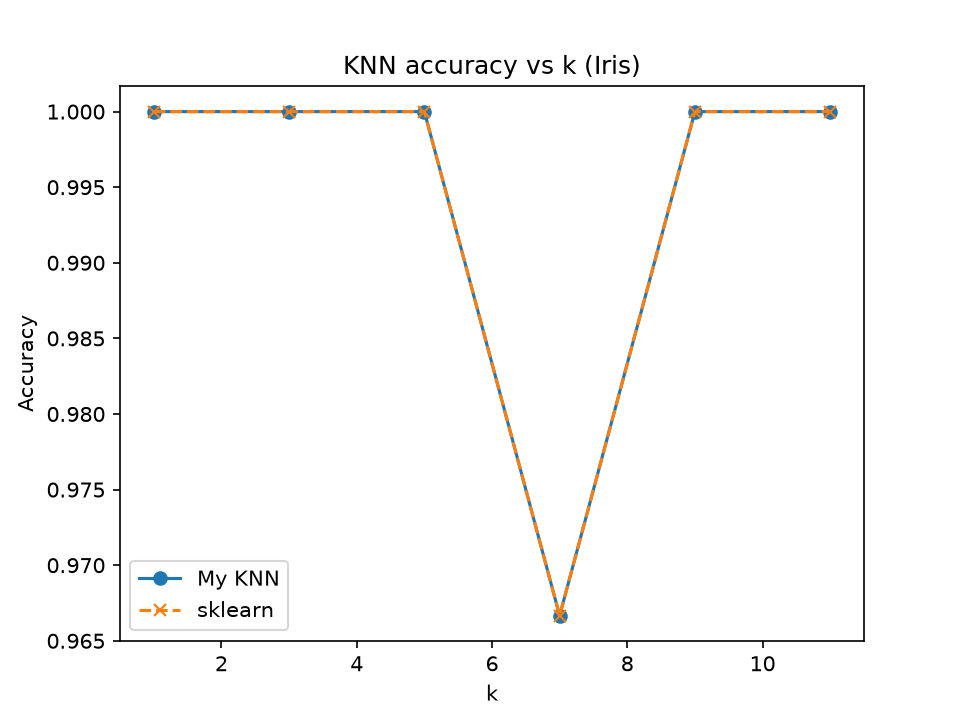

# KNN from Scratch

A k-Nearest Neighbors classifier implemented with NumPy only,
benchmarked against scikit-learn on the Iris dataset.

## How it works
1. Compute the Euclidean distance from a test point to every training point.
2. Pick the k closest points.
3. Predict the most common label among them.

## Run
```bash
pip install -r requirements.txt
python benchmark.py
```

## Results

| k | My KNN | sklearn |
|---|--------|---------|
| 1 | ...    | ...     |
| 3 | ...    | ...     |

(paste your real numbers here)



## What I learned
(1-2 sentences, e.g. how accuracy changes as k grows)

## License
MIT